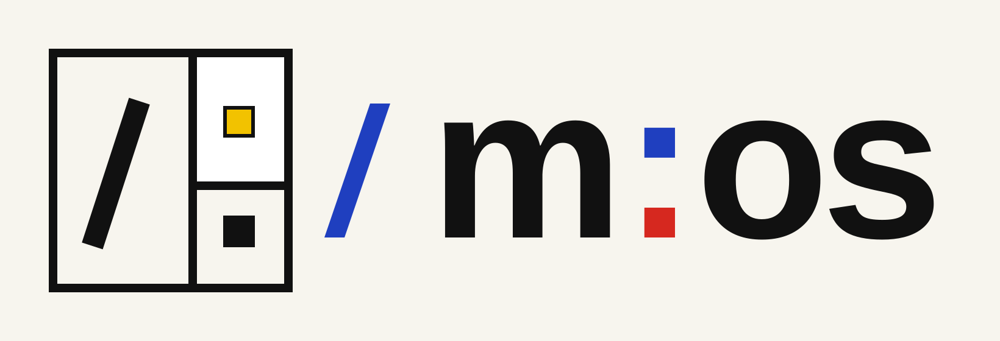
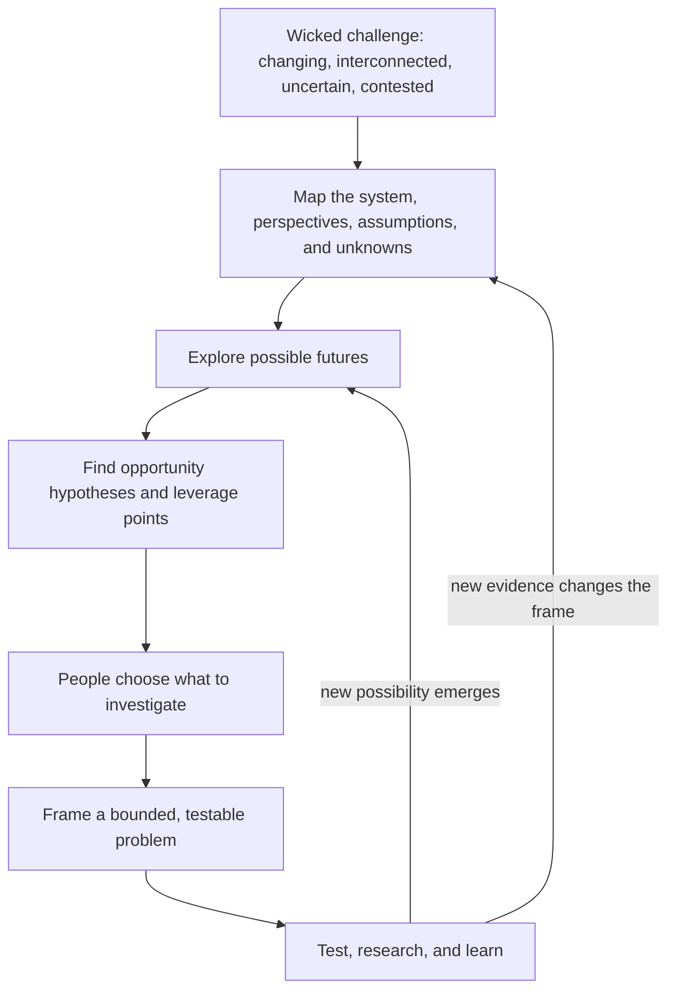
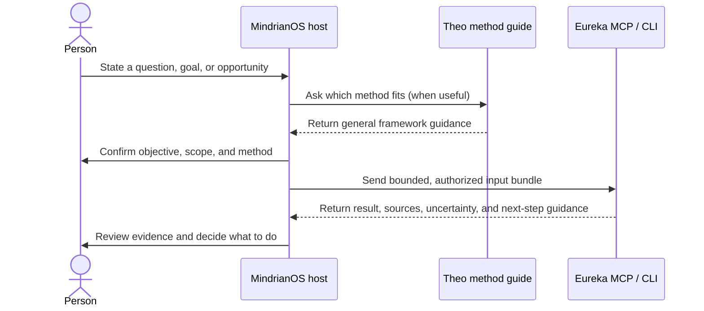

# MindrianOS Eureka

<p align="center"><strong>Extracting opportunities hidden in plain sight.</strong></p>
<p align="center">An adjunct intelligence service for MindrianOS · <code>/mos:eureka</code></p>
<p align="center">
  
</p>
<p align="center">
  
</p>
<p align="center"><em>Wicked problems are the uncertain context Eureka explores, not a problem it claims to solve.</em></p>

MindrianOS Eureka helps people explore uncertainty for opportunity. It supports the search across evolving, interconnected challenges with unclear boundaries, competing interpretations, and no single final formulation. Eureka helps map the challenge, imagine alternative futures, find opportunity hypotheses, and develop selected paths into problems that can be investigated and tested. It brings research, pattern finding, analogy, synthesis, and critical challenge into that work. People decide what matters and what to do next.

**Repository:** `mindrian-eureka` · **Runtime:** Python 3.11+ · **Use:** local CLI or stdio MCP, within the host's scope and approval rules

**Start here:** [Explore the method](#explore-wicked-problems-for-opportunity) · [Find a capability](#what-this-repository-provides) · [Run the CLI](#quick-start) · [Connect MindrianOS](#how-mindrianos-and-eureka-work-together) · [Check readiness](#readiness-at-a-glance) · [Contribute](#development) · [Review policies](#repository-policies)

> **Theo is the outside method thinker; the intelligence agents explore the case.** Together, they help the user inquire into uncertainty: Theo guides method choice, while the agents search the authorized material for patterns, mechanisms, contradictions, and promising questions. The Theo face moves through curiosity, searching, recognition, skepticism, decision, and handover. These are inquiry states, not a claim that a wicked problem has been solved. The host keeps room context, approvals, evidence review, and decisions.

## Explore wicked problems for opportunity

Wickedness is the operating context for this intelligence: a persistent, changing challenge whose parts affect one another and whose meaning may be contested. It is not a tidy prompt to solve once. The agents explore that uncertainty for possible opportunities, while the user and team decide what deserves attention. Within a wicked challenge, different questions call for different kinds of work:

| Inquiry mode | The question | The work |
|---|---|---|
| **Wicked challenge** | How does this changing system behave, who sees it differently, and where might change matter? | Map relationships, uncertainties, stakeholders, assumptions, and competing frames. Keep multiple perspectives alive; do not force premature closure. |
| **Undefined exploration** | What might an alternative future look like? | Imagine futures and trace what could change within them. Treat them as possibilities, not predictions. |
| **Ill-defined opportunity search** | What worthwhile opportunity might be emerging here? | Explore the system, field, and possible futures for needs, tensions, leverage points, and candidate problems. There may be many useful answers. |
| **Well-defined investigation** | Can this selected path meet explicit criteria? | Bound one testable part of the challenge with constraints and success measures, then investigate or test it. This makes progress on a wicked problem; it does not mean the whole problem is solved. |

The point is not to escape uncertainty as quickly as possible. Uncertainty can signal where existing explanations, technologies, and institutions have not settled the future, and where new opportunities may exist. Eureka helps the team explore that space, connect weak signals, reframe assumptions, and develop several evidence-linked possibilities. A team can make one path testable, learn from it, then return to the wider wicked challenge with better questions.



The agents should be useful in four ways: **research assistant** (find and organize source-linked material across the uncertain landscape), **method guide** (explain which inquiry fits the problem and why), **mentor** (help the user make the next move without collapsing the search too early), and **devil's advocate** (surface assumptions, counterevidence, boundary conditions, unintended effects, and falsifiers). Critique should improve the investigation, not automatically reject an idea. Agents must show uncertainty and never present a similarity, analogy, or generated hypothesis as proof of novelty, demand, or value.

## What this repository provides

This repository packages bounded methods behind CLI and MCP interfaces, with a readiness-aware catalog describing what each job needs and what its result means. Available local surfaces include:

- **Opportunity pair discovery:** find unusual pairs in an authorized collection; combine RS and HSI shortlists for follow-up.
- **Portfolio signals and critique:** compare wording and semantic patterns, inspect supplied taxonomy coverage, examine room-relative whitespace hypotheses, and run the deterministic Stage A grounding gates over MindrianOS-supplied local embeddings and graph neighbors.
- **Baseline whitespace:** identify underrepresented baseline concepts in a MindrianOS-authorized artifact projection using supplied same-model vectors; outputs are room-relative research leads.
- **External literature whitespace:** compare MindrianOS-authorized room vectors with papers retrieved through its approved research broker; surface retrieved-set gaps, gap-filling papers, and nearby cross-domain literature with source trails.
- **Problem-type-aware whitespace interpretation:** route mapped gaps as Un-Defined, Ill-Defined, Well-Defined, or Wicked using MindrianOS's framework graph; preserve framework IDs and return the appropriate next question and method chain for Theo.
- **Downstream reverse-salient whitespace:** inspect what a graph-identified bottleneck may be hiding beyond it, using the target section and framework vectors from the same authorized MindrianOS snapshot.
- **Opportunity graph harvest:** scan a complete MindrianOS-authorized graph snapshot for connected bridge, contradiction, whitespace, and related opportunity signals. Results are experimental review leads, not qualified opportunities.
- **Cross-domain reasoning:** retrieve supplied mechanisms, compare structural fit, map a selected mechanism to a target problem, and prepare evidence checks.
- **Research support:** prepare bounded multidisciplinary tasks and group returned findings supplied by the host.
- **Challenge and review:** compare text for restatement, audit claim/evidence traceability, and organize sourced perspectives for a human review.
- **Other analysis:** compare explicitly coded decision sequences under supplied models; validate and package proposed portfolio relationships.
- **Local graph discovery:** analyze an authorized MindrianOS graph snapshot for bounded structural and semantic relationship leads, with an optional focal-node projection.

Each catalogued algorithm or method is an independently callable service through CLI and MCP; Theo or MindrianOS may compose services when useful, but no single workflow is required to use them. These are not all complete source-engine workflows. Some catalog entries are blocked or planned; some callable services are experimental or need host-brokered research. The [engine jobs guide](docs/engine-jobs.md) explains when to use each family. The [algorithm origins and rationale register](docs/algorithm-origins-and-rationale.md) traces where each cataloged service came from and why it is exposed. The [capability catalog](docs/capability-catalog.md) and `eureka capabilities` command are authoritative for exact IDs, maturity, inputs, and limitations.

## Quick start

Install the package and inspect the available job contracts:

```bash
uv sync
uv run eureka capabilities
uv run eureka capability opportunity.find_cross_domain_pairs
uv run eureka schema graph.explore_local_relationships
```

`eureka capability <id>` reports the exact CLI executable and MCP tool for each runnable capability, along with its input and output schemas. Planned and blocked catalog entries have no invocation route.

For local MCP use, install the MCP and local encoder extras. Point Eureka at an already available model; the server does not download one:

```bash
uv sync --extra mcp-server --extra modern-encoder
MINDRIAN_EUREKA_RS_MODEL_PATH=/absolute/path/to/local-model uv run eureka-mcp
```

The server uses stdio MCP. Configure the host to launch this command in its MCP server settings. For a constrained container launch, see [Run the MCP server](#run-the-mcp-server).

To run a supporting stage directly, prepare the JSON request required by that capability and pass it to `eureka-workflow`:

```bash
uv run eureka-workflow portfolio.find_hybrid_similarity_pairs request.json --output result.json
uv run eureka-workflow portfolio.analyze_baseline_whitespace authorized-baseline-projection.json --output whitespace-leads.json
uv run eureka-workflow portfolio.classify_weak_signal_tail graph-signals.json --output tail.json
uv run eureka-workflow portfolio.prepare_candidate_critic candidate.json --output critic-variants.json
uv run eureka-workflow portfolio.inspect_candidate_grounding critic-input.json --output critic-result.json
uv run eureka-workflow portfolio.prepare_critic_rubric rubric-request.json --output rubric-prompts.json
uv run eureka-workflow portfolio.evaluate_critic_rubric rubric-evaluation.json --output rubric-result.json
uv run eureka-workflow research.run_genesis_local_plan graph-projection.json --output genesis-plan.json
uv run eureka-workflow research.analyze_rs_domain_projection rs-domain-projection.json --output rs-domain-analysis.json
uv run eureka-workflow research.score_rs_differential_pair rs-differential-request.json --output rs-differential-score.json
uv run eureka-workflow research.assess_rs_pair_set_quality rs-pair-set.json --output rs-pair-quality.json
uv run eureka-workflow research.generate_rs_query_matrix rs-query-context.json --output rs-query-matrix.json
uv run eureka-workflow research.generate_rs_thesis rs-thesis-request.json --output rs-thesis.json
uv run eureka-workflow research.classify_rs_pair rs-classifier-request.json --output rs-classification.json
uv run eureka-workflow research.preprocess_rs_documents rs-preprocessing-request.json --output rs-preprocessed.json
uv run eureka-workflow research.assess_rs_commercial_case rs-commercial-request.json --output rs-commercial-hypothesis.json
uv run eureka-workflow research.score_rs_breakthrough rs-breakthrough-request.json --output rs-breakthrough.json
uv run eureka-workflow research.extract_experts_from_papers approved-papers.json --output expert-candidates.json
uv run eureka-workflow analogy.cross_domain_research stage-request.json --output stage-result.json
```

Runnable catalog entries with CLI/MCP surfaces publish input and output JSON schemas. The generic `eureka-workflow` and `scout_run_workflow` routes enforce the published schemas, as do dedicated capability routes. The earlier MindrianOS adapter review exercised 53 then-current contracts; this repo now has 58 runnable catalog entries after the five graph algorithms were split into standalone services, and those five now pass source-suite, installed-wheel CLI, and installed-wheel stdio MCP checks. Real-user room evaluation remains outstanding. The host adapter is not yet merged or released, and its end-to-end live-session authorization remains unverified. The Genesis planner, weak-signal tail, critic, RS domain analyzer, RS classifier, breakthrough scorer, commercial assessor, preprocessor, and expert extraction workers require Node.js 22 or newer; the MCP container includes this runtime. The critic asks MindrianOS to supply locally computed embeddings and graph neighbors; it never opens the room graph. Its two rubric prompts must stay inside MindrianOS's approved local judge path. RS expert extraction processes only papers supplied by MindrianOS; it does not search, resolve the expert directory, or write to a room. `analogy.cross_domain_research` is called one stage at a time; MindrianOS performs approved research between local stages.

### Connect Eureka engines to the MindrianOS graph

The local graph is part of MindrianOS and remains its canonical knowledge layer at `<room>/.mindrian/room.db`. MindrianOS's `/mos:eureka` research-planner perspective and catalogued engine calls are separate, independently usable surfaces. Eureka engines interact with the local graph through an authorized, bounded snapshot supplied by MindrianOS over CLI or MCP; engines return traceable signals and stable graph references, while MindrianOS resolves evidence, routes review, and performs graph writes. The isolated MindrianOS adapter review worktree implements this projection path; it is not yet merged or released. The existing visualization export omits the content and source references engines need and is not the adapter. Snapshot JSON is the handoff contract, not a parallel graph. See the [MindrianOS graph integration contract](docs/integrations/mindrianos.md#mindrianos-graph-as-the-shared-knowledge-layer).

The optional direct Neo4j CLI connection below targets a separately configured Neo4j store. It does not read the room-local SQLite graph and has no MindrianOS room authorization broker, so it is only for development, replay, and controlled operator analysis.

`eureka-graph` runs graph-relations research algorithms read-only. For development use, install the optional Neo4j adapter and configure a local read-only graph account:

```bash
uv sync --extra neo4j
export NEO4J_URI='bolt://localhost:7687'
export NEO4J_USER='eureka_reader'
export NEO4J_PASSWORD='…'
export NEO4J_DATABASE='neo4j' # optional
uv run eureka-graph --neo4j --top 100 --output graph-candidates.json
```

For deterministic replay, use `uv run eureka-graph --snapshot graph-snapshot.json --seed 7`. Add `--focus NODE_ID --focus-hops 2` to project analysis onto a bounded undirected semantic neighborhood and disclose included IDs and omitted counts. This is an analysis projection, not an assertion that the node is a canonical Holon. Defaults use the source package's methodology labels and semantic relation types; check them against the MindrianOS graph schema and override with `--labels` and `--types` as needed. The CLI reads the configured graph, analyzes a snapshot, and does not write relationships. Candidates are hypotheses without evidence; validate them through MindrianOS and its human review path. The source's historical backtest did not validate ranking quality.

The other graph research jobs are callable with `--task backtest --snapshot graph.json`, `--task surprise --input beliefs.json`, `--task btm --input corpora.json`, and `--task traversal --input paths.json`. See `uv run eureka-graph --help` and the catalog entries beginning `graph.` for input meaning and limits. Surprise probabilities, BTM corpora, and path records must come from an authorized host workflow.

To compare two source/target neighborhoods using the bundled SME engine:

```bash
uv run eureka-graph --task sme-bridge --snapshot graph-snapshot.json \
  --base-node source-mechanism-id --target-node target-problem-id --hops 2 \
  --output structural-mapping.json
```

This uses only the supplied graph snapshot and bundled mapping code; no external `SME_LIB` install or network access is needed. Correspondences and candidate inferences remain hypotheses for source-backed review.

To send graph node text through RS/HSI, prepare the exact existing Scout bundle and run it with the existing signal engine:

```bash
uv run eureka-graph --task prepare-artifact-bundle --snapshot graph-snapshot.json \
  --objective 'Find relationships worth investigating' --scope-id 'room:authorized-snapshot' \
  --output scout-bundle.json
MINDRIAN_EUREKA_RS_MODEL_PATH=/absolute/path/to/local-model \
  uv run eureka-signal-scout scout-bundle.json --output scout-result.json
```

Install the local encoder first with `uv sync --extra modern-encoder`. MindrianOS must authorize the snapshot and resolve the returned `mindrian-graph://node/{id}` references. Use the MCP projection only with a host-authorized snapshot; the host can pass the resulting `artifacts` into its existing RS/HSI job.

The composite `graph.explore_local_relationships` capability is available through `eureka-workflow` and `scout_run_workflow` when MindrianOS supplies an authorized snapshot object. Its five core signals can also be invoked independently as `graph.find_structural_gaps`, `graph.find_network_holes`, `graph.find_bridge_pairs`, `graph.assess_edge_atypicality`, and `graph.find_semantic_gaps`; each has its own name, JTBD, input/output schema, and CLI/MCP route. MCP never resolves Neo4j credentials, room paths, or room permissions. See the [graph algorithm service contracts](docs/capability-catalog.md#capability-catalog) and [origin notes](docs/algorithm-origins-and-rationale.md).

See [the Holonic Focus and Discovery seed](gsd/mindrianos-holonic-discovery/PROJECT.md) for the architecture audit and implementation plan.

See [Using capabilities](docs/using-capabilities.md) and the relevant capability page for request schemas and examples. Direct CLI use runs only the named computation; it does not establish MindrianOS room scope or approval.

## How MindrianOS and Eureka work together



**MindrianOS owns** the user conversation, room access, scope, approval gates, Theo calls, external research, human decisions, and portfolio or graph writes. **Eureka owns** the capability catalog, bounded computations, local job state, validation, and result provenance. Eureka does not read room paths, call Theo, fetch unapproved research, issue `/mos:*` commands, or write to the MindrianOS portfolio.

The isolated adapter review worktree connects MindrianOS's authorized graph projection to this repo's capability MCP. It is not yet merged into the active plugin checkout or released, so the user-facing `/mos:eureka` research-planner flow must still be described separately from a catalogued engine call. See the [host integration contract](docs/integrations/mindrianos.md) for the boundary and handoff.

## Run the MCP server

### Local process

```bash
uv sync --extra mcp-server --extra modern-encoder
MINDRIAN_EUREKA_RS_MODEL_PATH=/absolute/path/to/local-model \
  MINDRIAN_EUREKA_DATA_DIR=/absolute/path/to/eureka-data \
  uv run eureka-mcp
```

`MINDRIAN_EUREKA_DATA_DIR` holds job and cache data. Keep it in a location that follows the room's data handling and retention policy. Direct local execution is useful for development but does not provide OS-level isolation.

### Container process

```bash
docker build -t mindrian-eureka:local .
export MINDRIAN_EUREKA_RS_MODEL_PATH=/absolute/path/to/local-model
export MINDRIAN_EUREKA_DATA_DIR=/absolute/path/to/eureka-data
scripts/run-mcp-container
```

The wrapper disables network access, mounts the model read-only, makes the container root filesystem read-only, and applies configurable CPU and memory limits. The model must already exist on the host.

## Readiness at a glance

| Area | Current state |
|---|---|
| RS opportunity-pair discovery | Runnable CLI and durable stdio MCP jobs; experimental pending evaluation. |
| RS + HSI signal scout | Runnable shortlist union; it does not fuse scores or qualify opportunities. |
| SME mapping and research handoff | Local mapping and bounded workflow stages; external research is host-brokered and source/license review remains open. |
| HSI, analogy, Genesis, Jason, BONO, graph stages | Selected CLI/MCP stages are callable; full-family workflows have mixed or incomplete readiness. |
| OMM decision-sequence analysis | Experimental; not an opportunity finder or validated measure of a person's ability. |
| MindrianOS integration | Contract is documented; the `/mos:eureka` adapter remains outstanding. |

See the [machine-readable capability catalog](src/mindrian_eureka/data/capability-catalog.v1.json) for the complete status of each stable capability ID. See the [JHTV opportunity assessment](evaluations/room-runs/jhtv-opportunity-leads-2026-10-18.md) for an example of results framed as diligence leads with supporting evidence and disqualifying questions.

## Development

```bash
uv sync --extra mcp-server
uv run eureka capabilities
```

Useful entry points:

- `eureka`: inspect capability and host-workflow contracts.
- `eureka-mcp`: start the stdio MCP server.
- `eureka-pair-scout`: find cross-domain pair leads from a prepared request (`eureka-rs` remains a compatibility alias).
- `eureka-structure-mapping`: map structures and prepare host-brokered verification research (`eureka-sme` remains a compatibility alias).
- `eureka-decision-sequences`: compare decision-sequence models (install the `hmm` extra; `eureka-omm` remains a compatibility alias).
- `eureka-workflow`: run a named supporting capability stage.
- `eureka-signal-scout`: run the local RS + HSI signal scout (`eureka-scout` remains a compatibility alias).

See [Using capabilities](docs/using-capabilities.md) for CLI and MCP examples, [Architecture](docs/architecture.md) for system design, and [Engine jobs](docs/engine-jobs.md) for JTBD and method guidance.

## Repository policies

[Contributing](CONTRIBUTING.md) · [Security](SECURITY.md) · [M:OS brand application](docs/brand-application.md) · [Licensing and provenance](docs/licensing-and-provenance.md). This repo has no blanket license because some source-derived methods still need rights review.

## Theo's role and face

Theo is MindrianOS's outside method thinker. The face is a reasoning cue, not decoration: curiosity opens a question, searching gathers material, recognition marks a possible connection, skepticism tests it, and decision/handover returns agency to the person. Pair every pose with clear language so the method remains understandable without the visual. Theo's current MCP provides general framework guidance; it does not receive arbitrary room material or judge a specific Eureka result. The host owns the boundary and any case-specific review.

