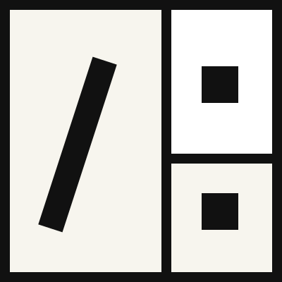
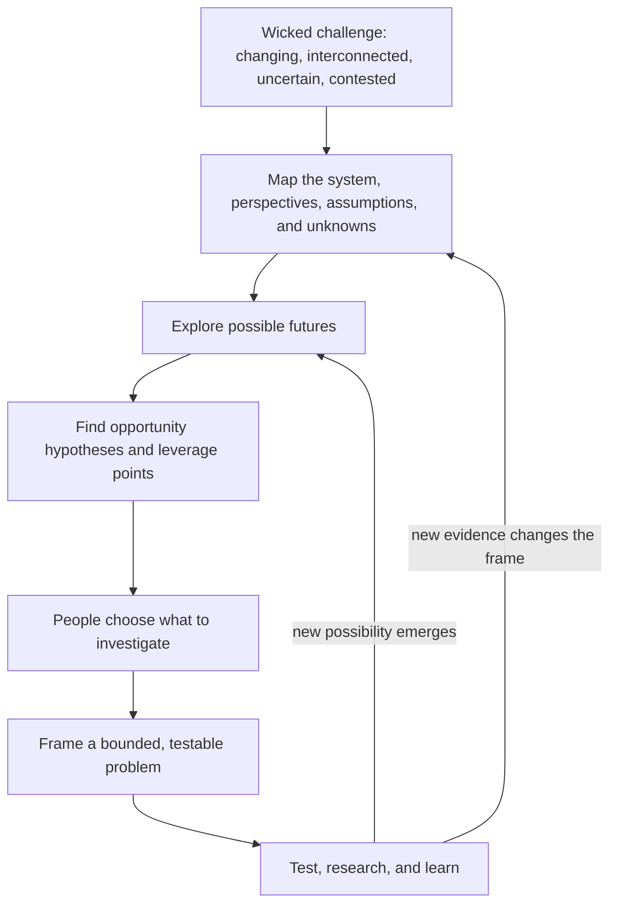
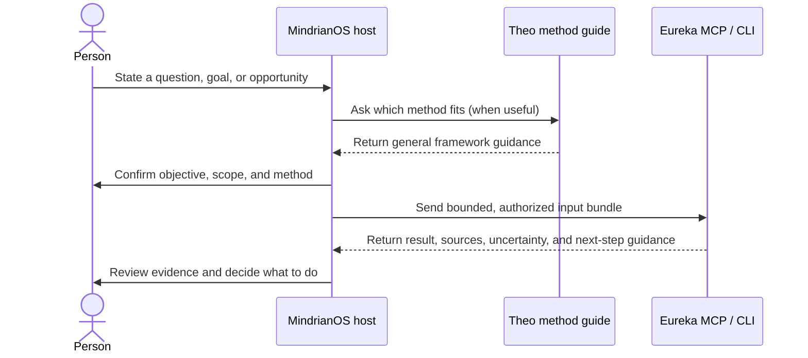

# MindrianOS Eureka

<p align="center">
  
</p>

**Extracting opportunities hidden in plain sight.**

MindrianOS Eureka is an intelligence system built to search uncertainty for opportunity. Its central challenge is the **wicked problem**: an evolving, interconnected situation with unclear boundaries, competing interpretations, and no single final formulation or solution. Eureka helps people map that uncertainty, imagine futures, find opportunity hypotheses, and develop selected paths into problems that can be investigated and tested. It uses research, pattern finding, analogy, synthesis, and critical challenge to reveal where useful possibilities may lie. People decide what matters and what to do next.

**MindrianOS entrypoint:** `/mos:eureka` · **Repository:** `mindrian-eureka` · **Runtime:** Python 3.11+

> **Theo is the outside method thinker; the intelligence agents explore the case.** Together, they help the user inquire into uncertainty: Theo guides method choice, while the agents search the authorized material for patterns, mechanisms, contradictions, and promising questions. The Theo face moves through curiosity, searching, recognition, skepticism, decision, and handover. These are inquiry states, not a claim that a wicked problem has been solved. The host keeps room context, approvals, evidence review, and decisions.

## Explore wicked problems for opportunity

Wickedness is the operating context for this intelligence: a persistent, changing challenge whose parts affect one another and whose meaning may be contested. It is not a tidy prompt to solve once. The agents explore that uncertainty for possible opportunities, while the user and team decide what deserves attention. Within a wicked challenge, different questions call for different kinds of work:

| Inquiry mode | The question | The work |
|---|---|---|
| **Wicked challenge** | How does this changing system behave, who sees it differently, and where might change matter? | Map relationships, uncertainties, stakeholders, assumptions, and competing frames. Keep multiple perspectives alive; do not force premature closure. |
| **Undefined exploration** | What might an alternative future look like? | Imagine futures and trace what could change within them. Treat them as possibilities, not predictions. |
| **Ill-defined opportunity search** | What worthwhile opportunity might be emerging here? | Explore the system, field, and possible futures for needs, tensions, leverage points, and candidate problems. There may be many useful answers. |
| **Well-defined investigation** | Can this selected path meet explicit criteria? | Bound one testable part of the challenge with constraints and success measures, then investigate or test it. This makes progress on a wicked problem; it does not mean the whole problem is solved. |

The point is not to escape uncertainty as quickly as possible. Uncertainty can signal where existing explanations, technologies, and institutions have not settled the future—and where new opportunities may exist. Eureka helps the team explore that space, connect weak signals, reframe assumptions, and develop several evidence-linked possibilities. A team can make one path testable, learn from it, then return to the wider wicked challenge with better questions.



The agents should be useful in four ways: **research assistant** (find and organize source-linked material across the uncertain landscape), **method guide** (explain which inquiry fits the problem and why), **mentor** (help the user make the next move without collapsing the search too early), and **devil's advocate** (surface assumptions, counterevidence, boundary conditions, unintended effects, and falsifiers). Critique should improve the investigation, not automatically reject an idea. Agents must show uncertainty and never present a similarity, analogy, or generated hypothesis as proof of novelty, demand, or value.

## What this repository provides

This repository packages bounded methods behind CLI and MCP interfaces, with a readiness-aware catalog describing what each job needs and what its result means. Available local surfaces include:

- **Opportunity pair discovery:** find unusual pairs in an authorized collection; combine RS and HSI shortlists for follow-up.
- **Portfolio signals:** compare wording and semantic patterns, inspect supplied taxonomy coverage, and examine room-relative whitespace hypotheses.
- **Cross-domain reasoning:** retrieve supplied mechanisms, compare structural fit, map a selected mechanism to a target problem, and prepare evidence checks.
- **Research support:** prepare bounded multidisciplinary tasks and group returned findings supplied by the host.
- **Challenge and review:** compare text for restatement, audit claim/evidence traceability, and organize sourced perspectives for a human review.
- **Other analysis:** compare explicitly coded decision sequences under supplied models; validate and package proposed portfolio relationships.

These are not all complete source-engine workflows. Some catalog jobs are blocked or planned; some callable stages are experimental or need host-brokered research. The [engine jobs guide](docs/engine-jobs.md) explains when to use each family. The [capability catalog](docs/capability-catalog.md) and `eureka capabilities` command are authoritative for exact IDs, maturity, inputs, and limitations.

## Quick start

Install the package and inspect the available job contracts:

```bash
uv sync
uv run eureka capabilities
uv run eureka capability opportunity.find_cross_domain_pairs
```

For local MCP use, install the MCP and local encoder extras. Point Eureka at an already available model; the server does not download one:

```bash
uv sync --extra mcp-server --extra modern-encoder
MINDRIAN_EUREKA_RS_MODEL_PATH=/absolute/path/to/local-model uv run eureka-mcp
```

The server uses stdio MCP. Configure the host to launch this command in its MCP server settings. For a constrained container launch, see [Run the MCP server](#run-the-mcp-server).

To run a supporting stage directly, prepare the JSON request required by that capability and pass it to `eureka-workflow`:

```bash
uv run eureka-workflow portfolio.find_hybrid_similarity_pairs request.json --output result.json
```

See [Using capabilities](docs/using-capabilities.md) and the relevant capability page for request schemas and examples. Direct CLI use runs only the named computation; it does not establish MindrianOS room scope or approval.

## How MindrianOS and Eureka work together



**MindrianOS owns** the user conversation, room access, scope, approval gates, Theo calls, external research, human decisions, and portfolio or graph writes. **Eureka owns** the capability catalog, bounded computations, local job state, validation, and result provenance. Eureka does not read room paths, call Theo, fetch unapproved research, issue `/mos:*` commands, or write to the MindrianOS portfolio.

The MindrianOS `/mos:eureka` adapter to this repo's capability MCP is still to be wired. Until it is, a user-facing MindrianOS run must not be described as calling Eureka automatically. See the [host integration contract](docs/integrations/mindrianos.md) for the complete boundary and handoff.

## Run the MCP server

### Local process

```bash
uv sync --extra mcp-server --extra modern-encoder
MINDRIAN_EUREKA_RS_MODEL_PATH=/absolute/path/to/local-model \
  MINDRIAN_EUREKA_DATA_DIR=/absolute/path/to/eureka-data \
  uv run eureka-mcp
```

`MINDRIAN_EUREKA_DATA_DIR` holds job and cache data. Keep it in a location that follows the room's data handling and retention policy. Direct local execution is useful for development but does not provide OS-level isolation.

### Container process

```bash
docker build -t mindrian-eureka:local .
export MINDRIAN_EUREKA_RS_MODEL_PATH=/absolute/path/to/local-model
export MINDRIAN_EUREKA_DATA_DIR=/absolute/path/to/eureka-data
scripts/run-mcp-container
```

The wrapper disables network access, mounts the model read-only, makes the container root filesystem read-only, and applies configurable CPU and memory limits. The model must already exist on the host.

## Readiness at a glance

| Area | Current state |
|---|---|
| RS opportunity-pair discovery | Runnable CLI and durable stdio MCP jobs; experimental pending evaluation. |
| RS + HSI signal scout | Runnable shortlist union; it does not fuse scores or qualify opportunities. |
| SME mapping and research handoff | Local mapping and bounded workflow stages; external research is host-brokered and source/license review remains open. |
| HSI, analogy, Genesis, Jason, BONO, graph stages | Selected CLI/MCP stages are callable; full-family workflows have mixed or incomplete readiness. |
| OMM decision-sequence analysis | Experimental; not an opportunity finder or validated measure of a person's ability. |
| MindrianOS integration | Contract is documented; the `/mos:eureka` adapter remains outstanding. |

See the [machine-readable capability catalog](src/mindrian_eureka/data/capability-catalog.v1.json) for the complete status of each stable capability ID. See the [JHTV opportunity assessment](evaluations/room-runs/jhtv-opportunity-leads-2026-10-18.md) for an example of results framed as diligence leads with supporting evidence and disqualifying questions.

## Development

```bash
uv sync --extra mcp-server
uv run eureka capabilities
```

Useful entry points:

- `eureka` — inspect capability and host-workflow contracts.
- `eureka-mcp` — start the stdio MCP server.
- `eureka-rs` — run RS pair discovery from a prepared request.
- `eureka-sme` — run SME mapping and research workflow stages.
- `eureka-omm` — run decision-sequence analysis (install the `hmm` extra).
- `eureka-workflow` — run a named supporting capability stage.
- `eureka-scout` — run the local RS + HSI signal scout.

See [Using capabilities](docs/using-capabilities.md) for CLI and MCP examples, [Architecture](docs/architecture.md) for system design, and [Engine jobs](docs/engine-jobs.md) for JTBD and method guidance.

Repository policies: [Contributing](CONTRIBUTING.md) · [Security](SECURITY.md) · [Licensing and provenance](docs/licensing-and-provenance.md). This repo has no blanket license because some source-derived methods still need rights review.

## Theo's role and face

Theo is MindrianOS's outside method thinker. The face is a reasoning cue, not decoration: curiosity opens a question, searching gathers material, recognition marks a possible connection, skepticism tests it, and decision/handover returns agency to the person. Pair every pose with clear language so the method remains understandable without the visual. Theo's current MCP provides general framework guidance; it does not receive arbitrary room material or judge a specific Eureka result. The host owns the boundary and any case-specific review.

