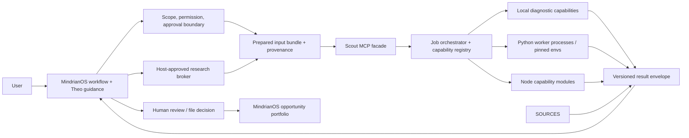

# MindrianOS Eureka: standalone repository architecture

**Status:** architecture baseline with local RS, SME, OMM, HSI, and Jason interfaces plus supporting discovery workflow stages; only RS currently has the durable job lifecycle.
**Purpose:** define an independently buildable intelligence runtime that MindrianOS can call to explore uncertainty—especially wicked challenges—for evidence-linked opportunity discovery across authorized room material and explicitly approved research.
**Scope:** the capability catalog, local engines, and host handoff contract. The adapter from the existing MindrianOS `/mos:eureka` research-planner workflow, OS-level worker sandbox for every capability, external research broker, and most engine migrations remain unimplemented.

## 1. Decision summary

Create a standalone repository named **`mindrian-eureka`**. Integrate it with MindrianOS's existing **`/mos:eureka`** user workflow. Eureka's intelligence agents are built to search uncertainty, particularly in wicked problems, for alternative frames, future possibilities, connected signals, and opportunity hypotheses. The repo owns reusable methods and bounded job execution. MindrianOS remains the user-facing host and the source of truth for room permissions, approval gates, room data, and opportunity decisions. The system must preserve uncertainty and competing frames rather than forcing premature problem closure.

The standalone repo should provide:

1. A **unified MCP-facing service** for MindrianOS to start and inspect scout jobs.
2. A **capability registry** describing what each method does, when to hire it, required inputs, dependencies, egress, maturity, and output.
3. A **job orchestrator** that selects or runs explicitly requested capability sequences and preserves state.
4. **Engine adapters and isolated workers** for reviewed methods. Python, Node, embedding, and network methods run behind versioned worker contracts.
5. Shared **input, result, provenance, and failure contracts** so MindrianOS can present results consistently.
6. Optional remote worker support only after the local contract and permission path are established.

Start as **one local MCP server with internal capability modules**. The RS container launcher supplies process/filesystem/network/resource boundaries; direct Python development runs only use the bounded thread pool. Keep module boundaries strong enough that an engine can later become a separate MCP server without changing MindrianOS's user-level workflow. Do not launch one MCP server per engine merely because there are multiple engine folders.

## 2. System boundary and ownership

| Responsibility | MindrianOS host | Opportunity Scout repo |
|---|---|---|
| User conversation, room/session binding | Owns | No direct ownership |
| User objective, scope, exclusions | Presents and records user choices | Validates the scoped request and identifies missing inputs |
| Room access and permissions | Owns authorization; supplies a bounded input manifest/bundle | Reads only the supplied/authorized inputs; cannot guess a room or expand scope |
| External research approval | Owns user gate and grants | Accepts only a host-supplied, approved bundle; no engine-owned credentials or unrestricted fetch |
| Framework guidance / Theo | Host obtains guidance and supplies authorized case context | Executes only the selected bounded method; returns monitorable stage artifacts |
| Engine methods and environments | Calls capabilities | Owns capability metadata, adapters, runtimes, job status, logs, results |
| Portfolio source of truth | Owns portfolio record, cross-room policy, review/disposition | Returns candidate proposals; never confirms or commits them |
| Truth/decision status | Human user and MindrianOS gates own promotion | Labels generated claims as hypotheses/proposals and preserves uncertainty |
| Remote execution | Defines consent and permitted data transfer | Runs only an explicit, minimized job capsule with expiry and return provenance |

**Key rule:** the Scout repo may return a candidate batch, but cannot write directly to MindrianOS room files, room graph, or canonical portfolio. MindrianOS validates results and asks the user before filing or changing truth/disposition state.

## 3. Architecture



### Execution modes

- **Local call:** MindrianOS starts the Scout MCP server as a local stdio process. It passes a scoped run request; the Scout returns a durable job handle and result references.
- **Local worker:** orchestrator invokes a capability in-process only when it is trusted, small, and easy to interrupt; otherwise it starts a bounded child process.
- **Remote job (later):** MindrianOS sends a minimized, approved research capsule to a remote endpoint. This is a distinct data boundary and requires explicit user policy, authentication, retention/deletion controls, and audit events.

MCP is the host/capability interface. It is not the process sandbox, durable queue, database, user-approval system, or model provider. The official MCP model distinguishes tools, resources, and prompts; use them for callable actions, application-provided context, and user-selected workflows respectively. [MCP server primitives](https://modelcontextprotocol.io/specification/draft/server/index)

## 4. Capability model and user-facing names

The user-facing names, JTBD descriptions, prerequisites, network boundaries, and maturity are maintained in the [machine-readable capability catalog](../src/mindrian_eureka/data/capability-catalog.v1.json) and summarized in the [capability catalog guide](capability-catalog.md). The catalog deliberately includes blocked and planned jobs so the host can explain what is not runnable. It is the source of truth; historical engine folder names are not user-facing capabilities.

The “Algorithms” folder contains separate methods: Genesis research planning, Jason pitch critique, and OMM decision-sequence analysis. They are not one executable. OMM now has a local implementation, but remains experimental and is not an opportunity finder or validated measure of reasoning ability.

## 5. Engine and worker architecture

Every capability implements a common interface, while retaining method-specific payloads:

```ts
interface Capability<I, O> {
  manifest: CapabilityManifest;
  validate(input: I): ValidationResult;
  run(input: I, ctx: RunContext): Promise<CapabilityResult<O>>;
}
```

Worker protocol is versioned JSON over stdin/stdout initially. Stdout carries only protocol messages; diagnostics go to stderr. The orchestrator owns timeout, cancellation, environment variables, file access, network policy, and retry/idempotency. A worker cannot write to the portfolio or declare its own egress audit as authoritative.

### Runtime policy

- TypeScript/Node control plane because MindrianOS is Node-based and existing MOS adapters are CommonJS. Keep protocol boundaries language-neutral.
- The current RS MCP capability runs Python work in a small bounded thread pool. The included Docker launcher adds no-network, read-only root/model mounts, dropped capabilities, no-new-privileges, and CPU/memory limits. The direct Python development command has no OS-level isolation.
- The MCP capability accepts text bundles, not paths, and does not fetch external sources. The host controls access to source data and validates grants before bundle transfer.
- The container launch passes only the configuration variables it needs; the direct development command inherits the user's process environment. Do not place unrelated secrets in the container's environment.
- Local analysis defaults to no model download. External material is supplied by the host's approved research broker.
- Input is read-only by default. Workers receive only the files or records listed in the run manifest.
- Return `failed`, `partial`, `blocked`, `cancelled`, and `completed_empty` distinctly. Missing models or dependency failures can never masquerade as “no opportunity.”
- Resource limits are explicit: wall-clock timeout, memory/CPU budget, maximum input size, maximum candidate count, search budget, and retry cap.

Docker describes container namespaces and cgroups for process/resource isolation, while also warning about incomplete isolation under some configurations. Therefore, network and data policies must be enforced by the host/runner and not inferred from containerization alone. [Docker Engine security](https://docs.docker.com/engine/security/)

## 6. Core contracts

### Capability manifest

Each capability ships a machine-readable manifest:

```yaml
id: analogy.map_structure
name: Test a Structural Analogy
jtbd: "When I have a specific source mechanism and target problem, test whether their relationships map."
status: experimental # enabled | experimental | blocked | retired
input_schema: schemas/analogy-map-input.v1.json
output_schema: schemas/analogy-map-output.v1.json
runtime: python-sme
network: denied
data_classes: [user-provided-derived-structure]
requires: [source_structure, target_structure]
side_effects: []
limitations: ["Mapping produces candidate inferences, not verified facts."]
evaluation: evals/analogy-map/
```

Manifest must also carry version, source/license provenance, dependency lock hash, resource bounds, supported OS/architecture, determinism expectations, input size limits, and a deprecation path.

### Run request

```json
{
  "schema_version": "scout.run.v1",
  "job_id": "caller-generated-idempotency-key",
  "capability_id": "bottleneck.diagnose",
  "objective": { "text": "...", "desired_decision": "...", "constraints": [] },
  "scope": {
    "scope_id": "opaque-host-reference",
    "snapshot_id": "sha256:...",
    "artifacts": [{ "id": "opaque-source-id", "sha256": "...", "media_type": "text/markdown" }]
  },
  "policy": {
    "network": "denied",
    "model_route": "none",
    "max_runtime_seconds": 120,
    "max_candidates": 25
  },
  "follow_up_of": null
}
```

The actual content is provided through a scoped local input bundle or a host-managed resolver, not arbitrary absolute paths supplied by the model. A `scope_id` is not authorization on its own; the host/adapter validates it against current room permissions.

### Result envelope

```json
{
  "schema_version": "scout.result.v1",
  "job_id": "...",
  "capability_id": "bottleneck.diagnose",
  "capability_version": "...",
  "status": "completed",
  "runner": {
    "artifact_digest": "sha256:...",
    "runtime": "python 3.x",
    "dependency_lock_digest": "sha256:...",
    "model_provider": null,
    "started_at": "...",
    "finished_at": "...",
    "exit_code": 0
  },
  "scope": { "snapshot_id": "sha256:...", "read_artifact_ids": ["..."] },
  "egress": { "events": [], "authoritative_source": "runner" },
  "outputs": [{ "id": "candidate-...", "kind": "bottleneck_hypothesis", "payload": {}, "source_refs": ["..."] }],
  "limitations": [],
  "warnings": [],
  "resource_use": { "duration_ms": 0, "tokens": null, "estimated_cost": null },
  "failure": null
}
```

Runner-generated records are authoritative for input hashes, runtime, egress, exit status, timeout, and retries. The engine supplies its method result, evidence references, and method-specific uncertainty. The host validates the envelope before showing or filing any result.

## 7. MCP surface

Expose a small user/workflow surface. Keep low-level engine invocation and run-control operations available to the MindrianOS orchestrator but do not force users to learn internal package names.

Current MCP tools include:

- `scout_capabilities` / `scout_capability` — list the packaged readiness-aware catalog or inspect one JTBD, prerequisites, and limits.
- `scout_plan` — transform objective + authorized scope into a proposed sequence and explain why; no execution or egress.
- `scout_start` — start a durable RS run; returns `job_id`.
- `scout_start_opportunity_signal_scout` — run RS and HSI on one local bundle and return their source-linked union; returns `job_id`.
- `scout_status` — inspect progress, partial results, blockers, and required user action.
- `scout_result` — retrieve a validated result envelope by job ID.
- `scout_cancel` — cancel a running job and prevent later stages from starting.
- `scout_record_review` / `scout_review_summary` / `scout_evaluation_report` — retain and summarize human ratings without automatic learning.
- `scout_delete_job` / `scout_clear_embedding_cache` — delete retained run data or derived embeddings.
- `scout_find_hybrid_similarity_pairs` / `scout_compare_text_differences` — run source-bounded HSI and Jason diagnostics from host-supplied bundles.
- `scout_assess_analogy_fitness` — compare sourced SAPPhIRE-layer structures through a local embedding model.
- `scout_run_workflow` — run one explicit local stage: coverage inventory, mechanism-corpus recall, Genesis planning/grouping, evidence-completeness audit, Six-Hat review preparation, relationship-proposal packaging, or selective scout planning. It never means “run all engines.”

RS and RS+HSI signal synthesis use the durable job lifecycle. SME mapping, research-bundle stages, OMM, typed HSI and Jason analysis, and selected workflow stages are direct calls. HSI can be called separately or included in the combined local scout. Evidence fetching is not implemented in this repository; MindrianOS's approved broker must prepare, authorize, and supply the external bundle. The capability catalog identifies which full engine jobs remain blocked or planned.

Potential MCP resources: `scout://capabilities`, `scout://jobs/{job_id}`, `scout://runs/{job_id}/manifest`. Potential prompts: `scout-opportunity`, `scout-bottleneck`, and `scout-deep-dive`. Prompts support user-selected entry points; MCP tools do the work; resources provide inspectable state.

MindrianOS should own presentation and approvals. Even when the Scout server supports the MCP protocol, no tool annotation is treated as an authorization control; runtime code validates grants and input scope.

## 8. Persistence, recovery, and portfolio boundary

The standalone repo needs **job persistence**, not a competing opportunity portfolio.

- Local development/first release: SQLite job ledger plus immutable run artifacts under a configurable data directory.
- Job states: `planned`, `awaiting_host_approval`, `queued`, `running`, `partial`, `completed`, `completed_empty`, `blocked`, `failed`, `cancelled`, `expired`.
- Persist job request hash, capability/version, snapshot ID, status transitions, checkpoints, bounded logs, result envelope, and timestamps.
- Idempotency key prevents duplicate external fetch or charges on retry.
- Resume from checkpoints only when inputs, capability version, policy, and grant remain valid.
- Grants expire and are revalidated at each outbound stage. Revocation stops not-yet-started outbound steps.
- MindrianOS stores canonical opportunity records and decisions. Scout results are proposals with opaque source refs; host resolves refs only when authorized.
- Room deletion/revocation must invalidate job access and remove derived artifacts according to an explicit retention policy.

## 9. Theo, ICM, and MindrianOS relationship

**MindrianOS is the product host.** It binds the user and room, applies the user’s privacy rules, invokes Theo/framework tools, translates selected criteria into a plan, and provides the only route to portfolio writes.

**Theo is the framework director/reviewer at the workflow layer.** The host supplies bounded stage inputs/results and asks Theo to select or apply a framework and identify gaps. The standalone runtime should not secretly call Theo or assume it can read Theo context. If Theo is later connected as a capability provider, that is declared in the manifest with model/egress details.

**ICM is the auditable run structure, not the runtime.** The standalone job engine can emit stage artifacts that an ICM workflow records/reviews. The scheduler, retries, locks, worker lifecycle, permission checks, and durable job state belong to software in the standalone repo or host.

The relationship:

```text
MindrianOS user workflow + room authority
   ├─ asks Theo for framework/review guidance
   ├─ creates scoped run request
   ├─ calls Scout MCP
   ├─ monitors Scout job and presents artifacts through ICM-style stages
   └─ validates and files user-approved portfolio decisions
                  ▲
                  │ MCP contracts and result envelopes
                  ▼
Standalone Opportunity Scout runtime
   ├─ capability registry and plan/job lifecycle
   ├─ local and Python/Node engine workers
   ├─ approved research broker
   └─ durable run artifacts; no canonical portfolio writes
```

## 10. Proposed long-term repository layout

This is the architecture target for later capability families. The repository exposes 58 experimental or host-brokered capability routes across RS, SME, decision-sequence analysis and fitting, HSI whitespace/pair scoring, analogy, Genesis planning, critic preparation, graph analysis, and research-support stages. Eight catalog entries remain explicitly blocked or planned. These method surfaces do not imply that every end-to-end lifecycle (external evidence gathering, portfolio qualification, or production validation) is implemented. MindrianOS graph projection adapters are committed on a feature branch and are not yet merged or released.

```text
mindrian-eureka/
├── README.md
├── LICENSE
├── SECURITY.md
├── CONTRIBUTING.md
├── CHANGELOG.md
├── package.json
├── package-lock.json
├── tsconfig.json
├── uv.lock / per-worker lock files
├── docs/
│   ├── architecture.md
│   ├── threat-model.md
│   ├── capability-catalog.md
│   ├── integrations/mindrianos.md
│   ├── decisions/ADR-*.md
│   └── operations/
├── schemas/
│   ├── capability-manifest.v1.json
│   ├── run-request.v1.json
│   └── run-result.v1.json
├── src/
│   ├── mcp/                 # public MindrianOS-facing server
│   ├── api/                 # contracts, validators, error taxonomy
│   ├── registry/            # capability manifests, status and routing
│   ├── orchestration/       # plans, jobs, state machine, cancellation
│   ├── policy/              # scope/grant validation; default-deny network
│   ├── provenance/           # snapshot hashes, run/evidence lineage
│   ├── persistence/          # local job ledger and artifact store
│   ├── workers/              # process manager, limits, IPC, redaction
│   ├── research-broker/      # outbound connector interface, no direct engine fetch
│   └── integrations/mindrianos/
├── capabilities/
│   ├── bottleneck-diagnose/
│   ├── portfolio-gap-finder/
│   ├── breakthrough-pair-scout/
│   ├── cross-field-mechanism-finder/
│   ├── structural-analogy-mapper/
│   ├── differential-claim-critic/
│   └── deliberation-structure/
├── workers/
│   ├── python-common/
│   ├── hsi/
│   ├── rs/
│   ├── sme/
│   └── algorithms/
├── evals/
│   ├── capability-contracts/
│   ├── routing/
│   ├── provenance/
│   └── end-to-end/
├── fixtures/                # synthetic/public data only
└── scripts/
    ├── dev-server
    ├── doctor
    └── package-worker
```

Do not copy engine folders wholesale into this repository. First record original source, author, license, modified files, third-party dependencies, and the right to redistribute. Migrate each capability only after its manifest, input/output contract, side effects, and evaluation case are understood.

## 11. Security and privacy model

### Data classes

Treat these as distinct classes, not a single “room data” flag:

1. local file content;
2. extracted spans/summaries;
3. embeddings and derived structures;
4. user objective and constraints;
5. external search query;
6. source response and citation metadata;
7. model prompts/outputs;
8. telemetry and logs.

Every capability declares which classes it reads, writes, and sends. “Runs locally” describes compute placement only; it does not imply local model inference or zero egress.

### Default-deny controls

- No network from analysis workers unless the orchestrator assigns a research-broker grant.
- No room-wide paths supplied by a model. Host resolves `scope_id` to a bounded manifest.
- No credentials inherited by child processes unless a broker token is explicitly scoped to one job/provider/action.
- No worker writes to room or portfolio data.
- No query fan-out without per-job count, time, and cost budgets.
- Do not execute engine code from unreviewed source in a user's room.
- Retention and deletion apply to inputs, vectors, caches, logs, external-source data, and derived candidates.
- Prompt-injection content in source artifacts is data, never authority to change scope, permissions, or tool calls.

Threat-model review must include malicious input documents, path traversal, symlink escapes, stale grants, retries after partial success, secret leakage in stdout/stderr, dependency supply-chain compromise, model prompt injection, and unauthorized cross-room reads.

## 12. Evaluation strategy

### Workflow recipe evaluation (later phase)

Harness² provides a useful design reference for evaluating and improving the harness around an agent. For Eureka, that means comparing versioned workflow recipes for a defined user job after capability contracts and reproducible run records exist. It does not mean engines rewrite themselves or production routing changes without review. See the [Harness² analysis](inspirations/harness2-analysis.md) for source-grounded details and limits.

Keep workflow variants in evaluation/shadow mode first. Hold input snapshot, capability versions, model/provider, permission policy, budget, and rubric constant against a baseline. Record output quality separately from execution success; if a judge fails, mark the evaluation unscored. A human explicitly adopts a recipe. The evaluation layer cannot expand scope, grant network access, modify engine code, or promote candidates into the canonical portfolio.

Do not build this recursive layer before the first local run can be replayed, audited, and evaluated with stable contracts. The build sequence should establish those prerequisites first.

Every capability needs its own contract evaluation and the system needs end-to-end evaluation.

- **Contract evaluation:** valid/invalid inputs, status semantics, schema, provenance completeness, determinism where promised, and failure behavior.
- **Isolation/permission evaluation:** network denied by default; approval and revocation; path/scope enforcement; secret allowlist; resource limits; cancel/retry correctness.
- **Method evaluation:** domain-specific baseline and known limitations. A score is only used for the purpose it was calibrated for.
- **Routing evaluation:** whether the selected capability matches the user job and available evidence; compare with user/analyst routing.
- **User independence evaluation:** can a user start, understand, recover, review, and file a result without developer intervention?
- **Portfolio evaluation:** source traceability, candidate uniqueness, decision usefulness, review time, stale-result handling, and reasons for park/reject.

Keep usability and discovery quality as separate experiments. Define the baseline, scope, scoring rubric, reviewer procedure, and thresholds before each evaluation. Do not use candidate count or engine count as the success metric.

## 13. Build sequence and exit criteria

### Phase 0 — Repository and license readiness

- Create the standalone git repository and establish license/security/contribution policy.
- Resolve source provenance and redistribution rights for each candidate engine.
- Freeze the first supported runtime and host protocol versions.

**Exit:** repo builds an empty MCP service; source/licensing ledger exists; no engine code imported without provenance. (Repository scaffold completed; RS source rights remain open.)

### Phase 1 — Contracts and local runtime shell

- Implement manifest, run request/result schemas, error taxonomy, job state machine, SQLite ledger, artifact store, and worker IPC.
- Implement `scout_capabilities`, `scout_plan`, `scout_start`, `scout_status`, `scout_result`, and `scout_cancel` with a synthetic capability.
- Enforce local scope and default-deny network.

**Exit:** contracts, SQLite jobs, idempotency, bounded queue, cancellation, and status history are implemented. Runtime recovery and isolation still need verification; execution is in-process and does not enforce OS-level network/filesystem confinement.

### Phase 2 — MindrianOS adapter

- Add a thin adapter in MindrianOS that passes scoped manifests and host-issued grants.
- Keep room selection, Theo workflow, user approval, and portfolio writes in MindrianOS.
- Validate returned result envelopes before display/filing.

**Exit:** a user can inspect scope, start a job, recover its status after restart, and review a proposed result without manual filesystem or command-line handling.

### Phase 3 — First real capability: cross-domain opportunity pairs

Implement the local RS pair-ranking method behind the capability manifest. Keep the PPTX-derived signal calculation as a reference path and make the modern sentence-transformer path an explicit variant. No network access occurs unless a user explicitly opts into model download; candidate scores remain leads for review, not validated opportunities. Connect each result to a bounded, evidence-linked review context for Theo or the user.

**Implementation:** CLI/MCP paths, source-linked result contract, local model loading, bounded input, cache, review capture, and evaluation summaries are present. **Exit remains open:** fixed-corpus and human usefulness evaluation, runtime behavior verification, source provenance/license resolution, and MindrianOS host integration.

### Phase 4 — Selected engine migration

Add one capability at a time. Require license/provenance, input/output contract, runtime profile, known limitations, an evaluation fixture, and failure states before enabling it. Do not promote all research-bundle engines together.

### Phase 5 — Approved evidence broker

Integrate exact-query planning, grants, fetches, source capture, cost/budget tracking, and egress audit. Disable direct network in every engine worker.

**Exit:** request-level audit agrees with actual network activity; revoked/expired grants stop future outbound calls; offline mode sends nothing.

### Phase 6 — Remote/paid worker (optional)

Add only after local execution and lifecycle are proven. Require per-job capsules, tenant isolation, authentication, destination-bound approvals, retention/deletion, observability, and restart recovery.

**Exit:** independent security review and explicit data owner approval for each enabled data class and provider.

## 14. Architecture choices to keep open

| Decision | Initial choice | Revisit when |
|---|---|---|
| MCP topology | One local MCP server; internal capabilities; stable contracts | A method has a distinct trust/credential/deployment boundary or independent release needs. |
| Worker language | Node/TypeScript control plane; Python subprocess workers where required | Engine maturity or distribution evidence justifies a different core. |
| Persistence | Local SQLite job ledger + run artifacts | Concurrent multi-user remote service needs a managed database/queue. |
| Input transfer | Host-authorized manifest and bounded local bundle | Payload size/performance requires a local scoped resolver protocol. |
| Portfolio data | MindrianOS owns it | Never move canonical portfolio authority into Scout without a product-level migration decision. |
| Theo | Host-mediated framework plan/review | A reviewed, approved Theo artifact-access integration exists. |
| Containers | Optional per worker | Native dependencies, untrusted code, or resource isolation requires them. |

## 15. Immediate design decisions for repo kickoff

1. Confirm repo name and remote location.
2. Choose whether initial delivery is **MindrianOS-only local MCP** or a reusable local CLI + MCP server. Recommendation: ship both entry points over the same core API so capability contracts can be exercised without the host.
3. Decide source/license policy before copying any research engine code.
4. Ratify the ownership boundary: Scout proposes; MindrianOS owns user permissions, canonical portfolio, and truth-state transitions.
5. Select one first capability only after a current-vs-package implementation audit.

