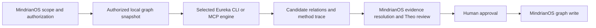

# Architecture audit and target proposal

## Verified existing architecture

- The local MindrianOS Plugin checkout stores each room's canonical graph in `<room>/.mindrian/room.db`; its `/mos:eureka` workflow already uses the research-planner `eureka` perspective to read the bound room graph and ICM structure.
- MindrianOS exposes a navigation-owned `getGraphExport`, but that contract is for visualization and deliberately omits raw node properties, source paths, and node text. It is not suitable as an engine projection.
- Eureka is a standalone Python package with CLI entry points, one MCP server, capability catalog, local job ledger for RS jobs, and direct stage calls for several other capabilities.
- `eureka capability` and `scout_capability` expose catalog metadata. The previously missing schema delivery path is now `eureka schema <capability-id>` and MCP `scout_capability_contract`; these resolve only schema paths listed by the packaged catalog.
- At the time of the earlier contract audit, the catalog had 61 capabilities and 53 runnable entries. Generic dispatch and mapped dedicated RS/combined-scout, graph CLI, SME, OMM CLI/MCP/loopback, Jason, HSI, and analogy-fitness routes enforced those contracts. Static route coverage passed; broad real MindrianOS request/result evaluation remains incomplete. See the current catalog update below for the five subsequently separated graph services.
- **Current catalog update (2026-10-19):** catalog version `2026-10-19+standalone-graph-algorithm-services` contains 66 capabilities: 58 runnable and 8 blocked/planned. Five algorithms previously available only inside the composite graph explorer now have individual typed CLI/MCP capability contracts. The full current suite passes 108 tests, 3 skipped, and 9 subtests; this verifies local synthetic execution, not real-room utility or MindrianOS authorization.
- ADR 0001 says MindrianOS owns room scope/permissions, user approvals, canonical portfolio, graph writes, and Theo; Eureka owns bounded engine execution and result contracts.
- Existing `scout_run_workflow` accepts bounded JSON payloads and dispatches selected local workflows. Current RS job lifecycle is more mature than generic workflow stages.
- Graph relationship source is a separate research package. It provides read-only graph snapshot analysis, but the original Neo4j adapter's labels/types and properties are assumptions that require graph-schema verification.
- This repo previously had `graph.package_relationship_proposals`, which checks/packages supplied candidates; it did not discover or rank relations.

## Evidence-based gap matrix

| Area | Verified now | Gap / unknown | Next action |
|---|---|---|---|
| Knowledge model | MindrianOS room graph is reported to be `.mindrian/room.db`; active plugin HEAD contains a generic navigation read projection but no `eureka_graph_project` handler or graph-to-Eureka bridge symbols | Live session authorization and canonical Holon/membership semantics remain unverified; historical host-bridge claims are not reproducible from the active checkout | Inspect ICM/DataRoom schema before defining Holon objects; implement and test the host-owned engine projection |
| Nesting | Some host workflows can group findings; graph source has ordinary edges | Strict containment, shared membership, cycle policy unknown | Map existing relation types and distinguish containment from semantic membership |
| Provenance | RS artifacts have source refs and hashes; graph proposal packager expects evidence references | Graph edge/source lineage completeness unknown | Require stable IDs, source references, and snapshot identity in host adapter |
| Focus/projections | No verified Focus Session or projection lifecycle in Eureka | Host equivalent and omission metadata unknown | Map Theo/ICM run context first; prototype projection only on authorized snapshot |
| Cross-boundary discovery | Graph algorithms rank structural/text signals; workflow planning can recommend stages | No validated cross-room authorization traversal or evidence-backed discovery | Host-filter data before transfer; keep candidates pending and evidence-empty until sourced |
| Human gate | Host owns approval; Eureka proposal states exist | Exact host review APIs/records unknown | Integrate through established Mindrian approval route, never add a parallel gate |
| Persistence | RS uses local SQLite job store | No canonical graph ownership in Eureka | Keep snapshot/run artifacts derived; no graph mutation |
| MCP/CLI | The rebuilt wheel contains all 58 catalog capabilities, 52 runnable routes, and 104 schema references resolving to 100 packaged schemas; the RS domain analyzer and differential scorer, runners, and schemas are present. Installed-wheel CLI and live stdio MCP calls pass for the differential scorer, and the domain analyzer also passes CLI and stdio MCP fixture calls. This verifies route execution and packaging, not host authorization or real-room ranking quality. The active MindrianOS Plugin checkout has no `eureka_graph_project`, graph analysis/SME/artifact bridge tools, Genesis bridge, or `test-eureka-live-bridge.cjs` | `/mos:eureka` does not orchestrate these Eureka engines; current host checkout does not project its local graph into the engine snapshot contract; real room-session authorization and downstream RS/HSI invocation remain untested | After the beta.73 cut, implement/recover the host bridge and prove it against active plugin source and real session binding |
| Capability contracts | Current catalog exposes 58 runnable experimental/host-brokered CLI/MCP entries with input/output schemas; shared workflow dispatch validates both directions | Real host cases and live session authorization remain unverified | Exercise every schema against real host request/result pairs and wire the MindrianOS adapter |
| Security | MCP accepts caller-supplied bundle and avoids paths/network research | Local graph connection authorization belongs to operator/host; metadata leakage scope unknown | Read-only Neo4j role, label/type allowlists, host authorization before snapshot supply |

## Proposed target architecture

The local graph is MindrianOS's canonical knowledge layer, shared by its own workflows and attached Eureka engines. MindrianOS authorizes graph scope and resolves a consistent snapshot/projection from that graph. Eureka runs selected, bounded methods against the host-supplied view and returns candidate links, method signals, run metadata, stable graph references, and limitations. MindrianOS resolves evidence, requests human review, and performs any accepted graph write. Snapshot JSON is a transport contract for graph data, not a second graph or canonical store.

## Component interfaces

- **Host projection primitive (not present in active plugin checkout):** the proposed `eureka_graph_project` should require explicit node IDs, bind the session room and verified room identity, open a read-only handle through navigation, and return only selected node fields plus induced edges and a content-derived snapshot ID. It must not silently expand to neighbors. The active checkout has a generic `room-projection.cjs` change-feed reader, but no verified engine projection contract; inspect its actual interface before reusing it. The visualization export omits engine content and is not suitable as the engine snapshot.
- **CLI:** `--snapshot FILE` for reproducible fixture/replay analysis. `eureka-graph --neo4j` targets a separately configured Neo4j store and is a development/operator path, not the room-local SQLite graph integration; it has no room authorization broker.
- **Focus projection:** optional focal node plus bounded undirected semantic-edge radius; output lists included node IDs and omitted counts/policy. This is a derived projection, not a persisted Holon or a security boundary.
- **Graph-to-engine handoff:** graph-aware methods consume host-supplied snapshots; `graph.prepare_artifact_bundle` projects authorized graph node text into the existing RS/HSI artifact contract, preserving existing source refs or using resolvable `mindrian-graph://node/{id}` references. The returned bundle is validated by the existing Scout request validator; it does not fetch evidence or access MindrianOS room paths.
- **Critic local-judge handoff:** after Stage A passes, `portfolio.prepare_critic_rubric` returns source-authored neutral/adversarial prompts; MindrianOS runs its approved local judge and returns both responses to `portfolio.evaluate_critic_rubric`, which uses the source parser and code-derived verdict. Eureka makes no model call; calibration, opportunity qualification, and graph writes are not part of this integration.
- **Critic-to-graph handoff:** `portfolio.prepare_candidate_critic` returns exact source-defined mechanism variants and hashes; MindrianOS embeds them locally and queries nearest neighbors from the same authorized room snapshot; `portfolio.inspect_candidate_grounding` evaluates the supplied vectors/neighbors and returns candidate/scope/snapshot lineage. Eureka never reads `room.db`; this is deterministic Stage A only, without rubric, calibration, or graph writes.
- **Opportunity graph harvest:** `opportunity.harvest_graph_events` runs the LATEST graph-event signal/rubric logic over a complete MindrianOS-authorized snapshot and host-provided bank dedup state. It returns pending handles and experimental signals only. MindrianOS remains responsible for graph access, evidence resolution, review, and writes; the host projection adapter is still required.
- **Wicked/problem-type whitespace routing:** `portfolio.interpret_whitespace` consumes MindrianOS-provided HSI gap zones, framework-to-problem-type mappings, and framework sequencing edges. It preserves stable framework IDs, explicitly routes Wicked separately from Un-Defined/Ill-Defined/Well-Defined, and returns Theo questions plus source gate outcomes; it does not access the local graph or infer classification from raw text.
- **RS-seeded whitespace:** `portfolio.discover_rs_whitespace` consumes host-provided reverse salients, target-section artifact vectors/text, and framework vectors; it returns section-coverage leads with artifact/framework IDs and source refs. It neither reads nor writes the MindrianOS graph.
- **Additional graph algorithms:** CLI tasks expose temporal backtesting, caller-provided Bayesian surprise, BTM corpus comparison, ranking host-supplied traversal paths, and bounded neighborhood mapping through the bundled SME core. Upstream source/redistribution rights remain unresolved; this is local evaluation only.
- **MCP:** `scout_run_workflow` capability `graph.explore_local_relationships` accepts an authorized snapshot JSON object, never a filesystem path or implicit room identifier.
- **Result:** `eureka.graph-relationship-result.v1`; every result is `completed_analysis`, candidate state `proposed`, `evidence: []`, with method details and validation limitations.
- **Contracts:** graph CLI/MCP capability entries are versioned and link packaged JSON input/output schemas plus explicit record, focus, candidate, and null-round limits.
- **Mindrian graph adapter (not in active checkout):** no host graph projection or Eureka MCP bridge is verified in the current `MindrianOS-Plugin` HEAD. A stash entry is present, but stashed changes do not make the active checkout runnable. Implement the projection, invoke the declared Eureka MCP routes, preserve result IDs and source lineage, and test the host authorization and human review path. Room/scope IDs remain audit metadata, never proof of permission. Map graph semantic types without treating every relation as containment or every node as a Holon.

## Persistence and authorization

- The room-local SQLite graph remains canonical in MindrianOS. A purpose-bound engine projection has not been verified in the active plugin checkout; production use requires this host-owned boundary and real authorization/end-to-end tests.
- The existing visualization export is a strict, content-minimized display shape. Do not weaken or reuse it for engine analysis; create a separate purpose-bound projection through the same navigation boundary.
- Neo4j is accessed only by the direct CLI adapter using read access and source-supplied read-only Cypher, with configurable label/type filters. This adapter targets a separately configured Neo4j store, not `<room>/.mindrian/room.db`; it has no host authorization broker and is limited to development/operator use.
- MCP analysis is over host-supplied snapshot content; no MCP database credentials or path resolver are added.
- No graph writes, evidence fetching, cross-room traversal, or approval decisions are implemented in Eureka.
- Snapshot persistence/retention is operator- and host-owned. Stable snapshot IDs and data minimization need a host contract.

## Migration strategy

1. Keep existing capability and ADR contracts.
2. Add graph-relations as an experimental, independently callable capability.
3. Map MindrianOS's actual graph schema and authorization API, then implement the host adapter before production use; validate query compatibility and access scope with graph owners.
4. Evaluate algorithms on synthetic fixtures and authorized temporal snapshots; do not upgrade maturity until baselines pass.
5. Add Focus/Projection/Portal integration only after host schema, authorization, and human gate are mapped.
